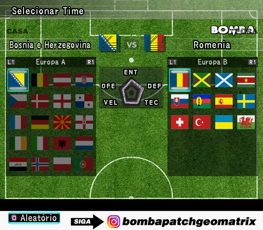

# Bomba Patch — port web experimental NovaPlay

Objetivo: adaptar o próprio Bomba Patch ao navegador, preservando a experiência do jogo.

## Estado verificado em 03/11/2026

- A ISO de referência contém Bomba Patch GeoMatrix de outubro de 2026. O menu identifica a edição como **Bomba Patch 2027**.
- Boot, telas de memória e abertura observados no runner nativo.
- **Menu principal observado**: Duelo, Master Liga, Liga, Copa, Treino, Editar e Opções.
- Navegação, Amistoso, configuração do jogador, seleção dos dois times e configurações da partida observados. Círculo confirma e X retorna nas telas verificadas.
- A abertura de 719 MB bloqueava a progressão no teste. Foi identificado e testado um salto da chamada da rotina de vídeo, que permitiu chegar ao menu. Esse patch preserva a ISO original e deve ser usado apenas com o executável exato abaixo.
- A compilação web produziu HTML, JavaScript, Wasm (~28 MiB) e dados (~2,8 MiB). A prévia HTTP não permite o isolamento exigido pela memória compartilhada; o jogo não foi validado no navegador.
- **Partida ainda não validada. Não há versão jogável publicada.**

Captura do runner nativo por software. Não é prova de partida nem de funcionamento no navegador.

## Edição e ferramenta

- ISO: 2.572.746.752 bytes; BOOT2 `cdrom0:\BPGE_010.26;1`, NTSC.
- Executável original SHA-256: `0236a6970622d0ba7c0f180de523403cc571fbf3f402e9f0d9f8cb77e77c7abd`.
- CRC informado pelo portador: `3EAACE68`.
- Ferramenta: https://github.com/snuri00/ps2-web-recomp, revisão `e026b971324068773eed88bf502437de9e581b6b` (MIT; preserve seus créditos).
- Patch experimental: uma instrução de chamada da abertura em `0x00175E38`, substituída por NOP. A instrução esperada na edição original é `0x0C235764`.

## Correções e validação

`runtime-fixes.patch` contém compatibilidade de operações vetoriais com GCC, tratamento de segmentos ELF BSS sem conteúdo, declarações separadas por módulo para reduzir recompilações e progresso opcional do runner por `PS2_PROGRESS=1`, captura sob demanda de páginas de código além das janelas declaradas e interpolação ancorada no rasterizador para preservar profundidade/alpha constantes.

As três regressões upstream passaram após a mudança do gerador. A normalização vetorial foi comparada em 400.000 casos. O carregador foi testado com reserva vazia fora da RAM, BSS cujo offset ultrapassa EOF e rejeição de dados inválidos. O teste de interpolação reproduziu deriva em 36.262 amostras antes da correção e passou depois. A captura de entradas além das janelas declaradas também tem regressão aprovada. Os testes estão neste diretório.

`entry-hints.py` adiciona candidatos de entrada somente a imagens de overlays alcançadas. `observed-entries.txt` preserva entradas alcançadas e candidatos de análise anteriores; nem todos foram executados. Não contém código do jogo. Copie ambos para `scripts/` do motor, usando o nome `novaplay_hints.py` para o Python.

A formação executou, mas apresentou faixas gráficas; a correção numérica removeu as faixas na comparação do mesmo estado. Ainda há artefatos, e a partida não foi validada.

## Construção local

Use Git, Python 3, CMake, Ninja, Clang com C++20 e Emscripten 6.0.11 para a versão web. O Clang incluído no SDK também foi usado no runner nativo. Prepare a revisão exata do motor e aplique `runtime-fixes.patch`.

Execute `build-local.sh /caminho/ps2-web-recomp /caminho/copia-propria.iso --skip-opening` para repetir o teste com a abertura pulada. Sem a opção, a abertura original é mantida. Sempre confira os logs e os frames: alcançar o limite de quadros não certifica gameplay.

O diretório não inclui ISO, executável comercial, código traduzido do jogo ou build jogável. O Bomba Patch e o jogo-base mantêm seus autores e créditos; NovaPlay identifica este trabalho de adaptação.

## Captura ampliada durante a partida

O teste de carregamento alcançou código além do limite original de 256 KiB. Para repetir a análise do mesmo estado de RAM, use `python3 capture-region.py /caminho/ram.bin /caminho/games/bomba-geomatrix-2026 940000 c78000 972330`, seguido de `entry-hints.py` e da tradução. Esses limites foram observados nesta edição; não são um mapa universal de outros jogos. O arquivo capturado contém bytes comerciais e permanece local. A ferramenta preserva a origem e não certifica o funcionamento da partida.

## Módulos originais MWo3 (fluxo atual)

A análise identificou cabeçalhos MWo3 em OVER.AFS. Base no offset 8, tamanho de texto no offset 12, texto a partir de 0x40. Os módulos de formação e gameplay coincidiram byte por byte com a RAM. Isso permite excluir dados mutáveis da análise e dos checks, corrigindo invalidações falsas das capturas anteriores.

`extract-mwo3.py <ISO verificada> <diretório mwo3> <mwo3-entries.txt>` extrai 35 módulos válidos em RAM e adiciona candidatos somente dentro do texto. O módulo de reserva fora da RAM é ignorado. Mantenha os binários extraídos locais.

A tradução atual usa `eerecomp <ELF patched> --entries <mwo3-entries.txt> --overlays <diretório mwo3> --out generated/bomba-mwo3`, seguida de CMake com `PS2_GENERATED` apontando para esse diretório. A análise produziu 641 unidades, comparadas a mais de 1.200 na exploração anterior.

`raw-image-bounds-test.cpp` verifica limites absolutos e leitura de dados sem marcá-los executáveis. `mwo3-bounds-test.py <eerecomp>` verifica a exclusão de dados mutáveis e a aceitação de módulos pequenos. Ambos passaram. A nova compilação ainda precisa ser validada no runner e no navegador.
